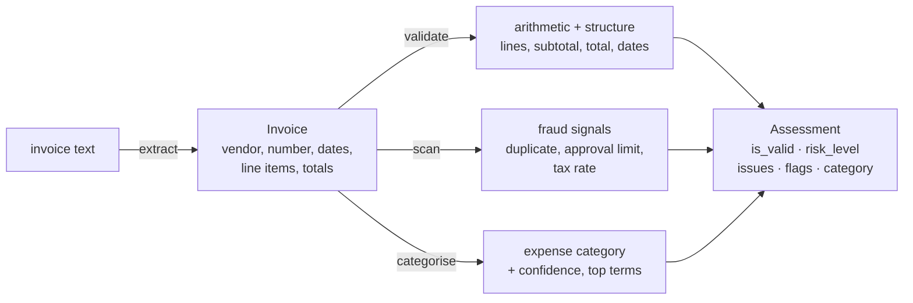

# InvoiceIQ

Invoice intelligence for accounts payable. It extracts the fields and line items
from invoice text, **checks that the numbers add up**, raises deterministic fraud
signals (duplicates, out-of-policy amounts, odd tax rates), and suggests an
expense category with an explainable model. The arithmetic and the fraud checks
are deterministic and auditable; the AI only *suggests* the category.

## Why it matters

The expensive mistakes in accounts payable are not exotic: a total that does not
equal subtotal plus tax, the **same invoice paid twice**, a bill quietly above
the approval limit. These are catchable with exact rules, and a system an auditor
can trust must *catch* them, not *predict* them. InvoiceIQ puts the deterministic
checks at the centre and uses machine learning only where a judgement call is
acceptable — proposing the expense category, which a human can override.

## How it works



1. **Extract (`extract.py`).** Deterministic parsing of a labelled-text invoice
   layout into a structured `Invoice`, with amounts in integer **cents**. Real
   invoices are PDFs or scans, so a production system puts OCR / a layout model in
   front; what this owns is the exact, traceable step from text to numbers.
2. **Validate (`validate.py`).** Checks that each line's `quantity × unit price`
   equals its amount, that the line amounts sum to the subtotal, and that
   `subtotal + tax` equals the total — in cents, with a small rounding tolerance.
   Each failure is an explained, machine-coded issue.
3. **Fraud scan (`fraud.py`).** Keeps a short history to catch the classic AP
   fraud — the **duplicate invoice** (same vendor + number, or same vendor,
   amount and date under a new number) — plus stateless heuristics (amount over
   the approval limit, implied tax rate far from expected).
4. **Categorise (`categorizer.py`).** A `FeatureUnion` of word and character
   TF-IDF views feeds a logistic regression that maps the line items to one of
   eight expense categories, with the words that drove the choice. Low confidence
   routes to review.

## Quick start

```bash
python -m venv .venv && source .venv/bin/activate
pip install -e ".[dev]"

python -m invoiceiq.cli demo          # clean, bad-math, duplicate, and over-limit invoices
uvicorn invoiceiq.main:app --reload   # HTTP API
```

```bash
curl -s -X POST localhost:8000/invoice/assess -H 'content-type: application/json' -d '{
  "text": "Vendor: Acme\nInvoice Number: INV-1\nIssue Date: 2026-02-03\n- Chairs: 4 x 120.00 = 480.00\nSubtotal: 480.00\nTax (19%): 91.20\nTotal: 571.20"
}'
```

## The invoice text layout

Extraction targets a common labelled-text layout (what an email body or an OCR
dump typically looks like):

```
Vendor: Acme Office Supplies Ltd
Invoice Number: INV-2026-0042
Issue Date: 2026-02-03
Due Date: 2026-03-05

- Office chairs: 4 x 120.00 = 480.00
- Standing desk: 1 x 350.00 = 350.00

Subtotal: 830.00
Tax (19%): 157.70
Total: 987.70
```

A subtlety worth noting: the totals parser uses word boundaries so that `Total`
is never captured from inside `Subtotal` — the kind of bug that silently corrupts
every downstream check.

## Configuration

Settings load from environment variables with the `IQ_` prefix (see `.env.example`):

| Variable                        | Default  | Meaning                                            |
| ------------------------------- | -------- | -------------------------------------------------- |
| `IQ_APPROVAL_LIMIT_CENTS`       | `500000` | Invoices at/above this are flagged for approval    |
| `IQ_EXPECTED_TAX_RATE`          | `0.19`   | Expected sales-tax rate                            |
| `IQ_TAX_RATE_TOLERANCE`         | `0.03`   | Tolerance before the implied tax rate is flagged   |
| `IQ_ARITHMETIC_TOLERANCE_CENTS` | `2`      | Rounding tolerance when checking that amounts add up |
| `IQ_CATEGORISER_MIN_CONFIDENCE` | `0.45`   | Below this, the category goes to manual review     |

## Evaluation: honest generalisation, not a memorised 1.0

The categoriser is trained on synthetic line items, so a random split would report
a meaningless ~1.0. `invoiceiq.evaluation` instead runs an **anchor-disjoint
split**: whole anchor keywords are held out of training, so the test descriptions
centre on vocabulary never seen in training — the realistic question of placing a
charge whose exact wording is new.

```
$ python -m invoiceiq.evaluation
  accuracy (mean+/-std over 6 seeds): 0.93 +/- 0.06   # eight categories; chance ~0.125; keywords unseen
  train accuracy                     : 1.00
  train-test gap                     : 0.07   # bounded -> learns the stem signal, not the templates
```

The command averages over seeds on purpose: a single split can land high, and
reporting that alone would be the same self-deception as a random split. The
categoriser can still be wrong, which is why it never decides alone — low
confidence goes to review, and the deterministic validation and fraud checks do
not depend on it at all.

## Testing

```bash
ruff check invoiceiq tests
pytest --cov=invoiceiq --cov-report=term-missing --cov-fail-under=80
```

The suite covers money parsing and field extraction (including the Subtotal/Total
boundary), every arithmetic rule (line, subtotal, total, rounding tolerance,
missing fields, date sanity), the fraud scanner (duplicate on resubmission,
possible-duplicate, approval limit, tax rate), the categoriser (sensible outputs
and the anchor-disjoint generalisation check), the HTTP API, and the CLI demo.

## Documentation

- `docs/architecture.md` — components, data flow, and design rationale.
- `docs/adr/` — the main design decisions and their trade-offs.
- `docs/estudio/` — a study guide in Spanish.

## A note on scope

InvoiceIQ is a reference implementation. A production system would add OCR /
layout parsing for PDFs and scans, persistence for the duplicate history,
per-vendor tax and approval policies, three-way matching against purchase orders
and receipts, and training the categoriser on real labelled invoices.

## License

MIT. See [LICENSE](LICENSE).
