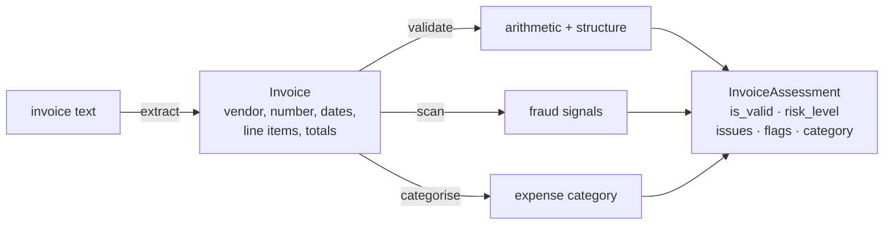

# Architecture

InvoiceIQ is a pipeline whose centre of gravity is deterministic. Extraction and
validation are exact and auditable; fraud signals are rule-based; only the
expense category is a model's suggestion.

## Components

| Component    | File                      | Responsibility                                     |
| ------------ | ------------------------- | -------------------------------------------------- |
| Models       | `invoiceiq/models.py`     | Typed `Invoice`, `LineItem`, `Finding`, assessment |
| Extract      | `invoiceiq/extract.py`    | Labelled text → structured invoice (cents)         |
| Validate     | `invoiceiq/validate.py`   | Line / subtotal / total arithmetic, dates          |
| Fraud        | `invoiceiq/fraud.py`      | Duplicate detection + policy heuristics            |
| Categoriser  | `invoiceiq/categorizer.py`| Line items → expense category, explained           |
| Generator    | `invoiceiq/generate.py`   | Synthetic line items + anchor-disjoint split       |
| Evaluation   | `invoiceiq/evaluation.py` | Anchor-disjoint generalisation measurement         |
| Service      | `invoiceiq/service.py`    | Orchestration                                      |
| HTTP API     | `invoiceiq/main.py`       | REST surface                                       |
| CLI          | `invoiceiq/cli.py`        | End-to-end demo                                    |

## Data flow

## Why integer cents

Every amount is an `int` number of cents. Floating-point money accumulates error
(`0.1 + 0.2 != 0.3`), and a validator that cannot add exactly would raise false
mismatches. Parsing happens once, at extraction; everything downstream is integer
arithmetic with an explicit rounding tolerance.

## Why deterministic checks lead, ML follows

An accounts-payable team needs to *trust* the output. A total mismatch or a
duplicate payment is a matter of fact, not probability, so it is decided by an
exact rule that explains itself. The expense category is a judgement call where a
confident suggestion saves time and a wrong one is cheaply corrected, so it is the
one place a model is used — and even there, low confidence defers to a human and
the category never affects `is_valid` or the fraud flags.

## Extraction owns the exact text-to-numbers step

Real invoices are PDFs and scans; turning those into text is an OCR / layout
problem that a production system solves upstream. This module deliberately owns
only the exact step from *text* to *numbers*, so every figure that feeds
validation is traceable to a span of the source text rather than invented.
